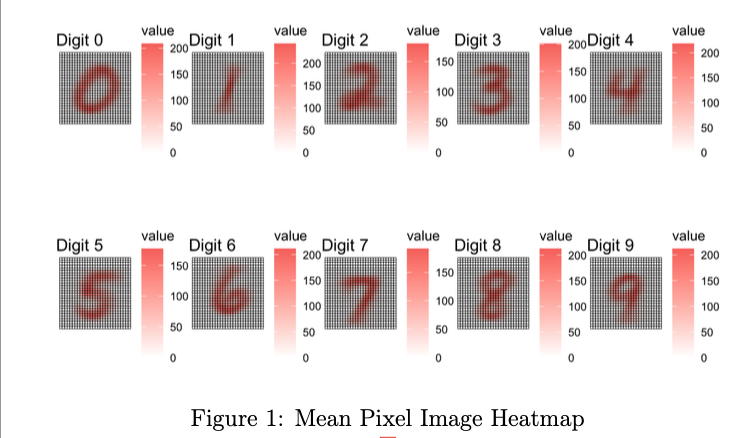
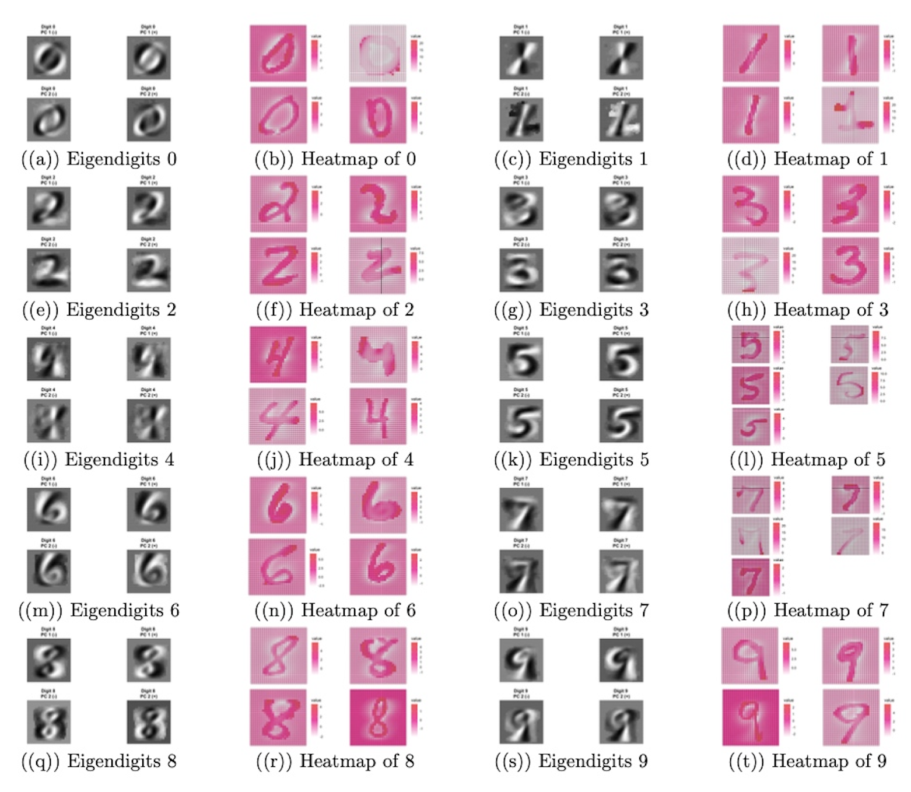
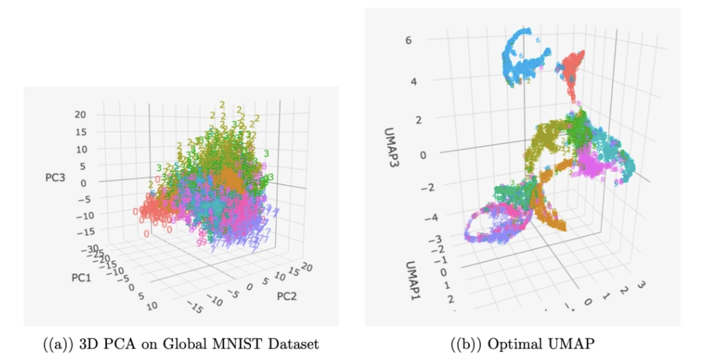

# Geometry Analysis of MNIST Digits 

**Authors:** Alisha Pham, Tianye Dou

## Overview
This project investigates the geometric and structural properties of the MNIST handwritten digits dataset using linear and nonlinear multivariate analysis techniques: **Principal Component Analysis (PCA)**, **Uniform Manifold Approximation and Projection (UMAP)**, and **Canonical Correlation Analysis (CCA)**. 

Specifically, our analysis addresses three core research questions:
1. **Within-Class Geometric Variation (PCA):** How do the leading principal directions (eigendigits) differ across digit classes (0–9), and what stylistic features drive within-digit variation?
2. **Global Manifold Representation (3D PCA vs. 3D UMAP):** How do linear (PCA) and nonlinear (UMAP) dimensionality reduction methods compare in representing the global MNIST manifold in three dimensions, and how do UMAP hyperparameters (`n_neighbors` and `min_dist`) govern cluster separation?
3. **Quantitative Horizontal Symmetry (PCA + CCA):** How strongly do the upper and lower halves of digit images correspond, and how can canonical correlations provide a numerical scale for structural symmetry?

---

## Dataset & Preprocessing
* **Sample Size:** 5,000 handwritten digit images (balanced across classes 0–9 with 500 samples per class).
* **Dimensionality:** Each $28 \times 28$ grayscale image is flattened into a $p = 784$ dimensional vector with pixel intensities in $[0, 255]$.
* **Preprocessing:** Standardization (zero mean, unit variance) is applied both to the global dataset and within individual class subsets prior to decomposition.
* **Exploratory Profiling:** 
  * Computed class-wise mean pixel heatmaps to identify baseline structural tendencies (e.g., rightward slant in digits `0, 1, 4, 5, 8, 9`; bottom strokes in `4, 7, 9`; loop variations in `2`).
  * Quantified background sparsity via the mean and standard deviation of zero-valued pixels per class. Digit `1` exhibits the highest background sparsity ($\mu = 699.13, \sigma = 19.67$), whereas Digit `0` occupies the largest spatial footprint ($\mu = 590.30, \sigma = 34.05$).

  
   
  <em>Figure 1: Class-wise mean pixel intensity heatmaps across digits 0–9.</em>

| Digit | Mean Zero Pixels | SD Zero Pixels | Digit | Mean Zero Pixels | SD Zero Pixels |
| :---: | :---: | :---: | :---: | :---: | :---: |
| **0** | 590.30 | 34.05 | **5** | 632.39 | 33.57 |
| **1** | 699.13 | 19.67 | **6** | 625.64 | 33.22 |
| **2** | 616.71 | 33.55 | **7** | 652.93 | 26.86 |
| **3** | 619.08 | 34.44 | **8** | 610.40 | 31.61 |
| **4** | 641.03 | 28.76 | **9** | 641.71 | 28.62 |

---

## Methodology & Key Findings

### 1. Within-Digit Variation via Eigendigits (PCA)
We performed class-specific PCA on the standardized pixel matrices for each digit (0–9) and inspected the positive and negative directions of the first two principal components ($\text{PC1}\pm, \text{PC2}\pm$) alongside extreme-score observations:
* **Slant & Orientation:** In digits such as `1`, `3`, and `8`, $\text{PC1}$ primarily isolates rotational tilt (left-leaning vs. right-leaning strokes).
* **Aspect Ratio & Loop Geometry:** For `0`, $\text{PC1}$ and $\text{PC2}$ capture circular vs. ovular geometry and diagonal stroke thickness. For `2`, `5`, `6`, and `9`, leading components separate looped vs. loopless styles and loop radius.
* **Stylistic Flourishes:** $\text{PC2}$ frequently isolates secondary calligraphic features, such as top hooks and horizontal base bars in `1` and `7`, flat vs. curved tops in `3`, and broken vs. continuous midsections in `8`.

  
   
  <em>Figure 2: Leading eigendigits (PC1±, PC2±) and extreme principal component score heatmaps for digits 0–9.</em>

### 2. Global Manifold Structure: 3D PCA vs. 3D UMAP
We projected the complete 5,000-image dataset into $\mathbb{R}^3$ to compare global linear variance preservation against local neighborhood graph embeddings:
* **3D PCA:** Produces a dense, heavily overlapping central cloud (particularly among `3, 5, 6, 8, 9`), demonstrating that discriminative structure across all 10 classes cannot be recovered by a 3D linear subspace.
* **UMAP Hyperparameter Sensitivity:**
  * `n_neighbors` (tested at `5` vs. `200`): Overly small values fragment classes into detached local subclusters; overly large values over-smooth local geometry and merge distinct classes.
  * `min_dist` (tested at `0.01` vs. `0.50`): Small values compress intra-class variance into dense points; large values expand clusters and induce boundary overlap.
* **Optimal 3D UMAP (`n_neighbors = 21`, `min_dist = 0.09`):** Achieves clear 3D class separation across all 10 digits, successfully disentangling nonlinear shape variations (such as `6` vs. `9`) that overlap in PCA space. Reciprocal cross-placements remain only among structurally ambiguous pairs (`0` vs. `6`, `4/7/9`, and shared boundary tails across `3/5/8`).

  
   
  <em>Figure 3: Comparison of 3D global MNIST embeddings using (a) PCA and (b) optimal UMAP (n_neighbors = 21, min_dist = 0.09).</em>

### 3. Quantifying Horizontal Symmetry via Top-Bottom CCA
To turn visual intuition about horizontal symmetry into a quantitative metric, we partitioned images from digits `0`, `2`, and `7` horizontally into upper halves ($X \in \mathbb{R}^{n \times 392}$, pixels 1–392) and lower halves ($Y \in \mathbb{R}^{n \times 392}$, pixels 393–784):
1. **Dimensionality Reduction Step:** To avoid high-dimensional overfitting and singularity in sample covariance matrices, we projected $X$ and $Y$ onto their leading $r = 50$ principal components ($X_r, Y_r \in \mathbb{R}^{n \times 50}$), retaining $\approx 90\%$ of variance in each half.
2. **Canonical Correlation Summation:** We computed the ordered canonical correlations $\rho_1 \ge \rho_2 \ge \dots \ge \rho_{50}$ and evaluated the cumulative canonical correlation score:
   $$S = \sum_{k=1}^{50} \rho_k$$

| Digit Class | Cumulative Canonical Correlation ($S$) | Structural Interpretation |
| :---: | :---: | :--- |
| **Digit 0** | **22.35** | **Highest correspondence:** Strong horizontal reflection symmetry between upper and lower arcs. |
| **Digit 7** | **19.61** | **Moderate correspondence:** Asymmetric top bar, but upper and lower halves share a continuous diagonal stem. |
| **Digit 2** | **18.31** | **Lowest correspondence:** Structural mismatch between the curved upper loop and flat horizontal base. |

---

## Limitations & Future Directions
* **Nonlinear Within-Class Modes:** Extending Question 1 using **Kernel PCA** or **Factor Analysis** to capture nonlinear stylistic variations without relying on subjective extreme-score selection.
* **Quantitative Embedding Evaluation:** Replacing visual hyperparameter tuning in UMAP with supervised/unsupervised cluster separation metrics (e.g., $k$-NN classification accuracy in $\mathbb{R}^3$ or Silhouette scores across multiple random seeds).
* **Generalized Symmetry Analysis:** Extending the PCA-CCA pipeline across all 10 digit classes, incorporating vertical (left-right) splits, and exploring kernel/nonlinear CCA to capture non-linearly coupled symmetries.
